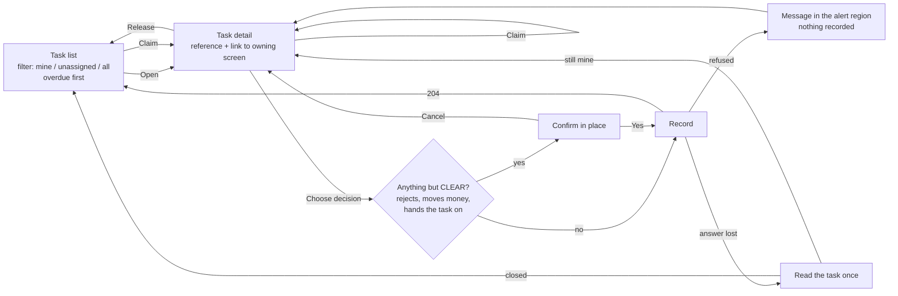
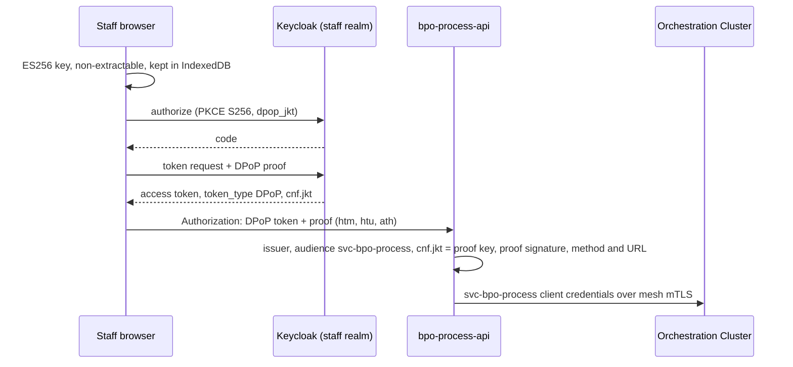

# Staff task UX: one screen set per human actor

Status: round 4 (paged task lists with server-side filter counts; four eyes also matches a maker task
recorded under the user's former name; round 3: coded decision reasons, queue groups from the identity realm, the engine assignee is `sub`; round 2: four eyes shown before deciding, unknown outcomes, confirmations that name the record, filter
counts and a new-task notice, task measures). Built: the controller layer (`services/bpo-process-api`) and the presentation layer
(`ui/bpo-staff-web`) for the four actors that have user tasks in this repository's models (the screening review
and the TR FAST payment exception). The other actors below are designed here so their screens follow the same
pattern when their models arrive.

## 1. Rules the screens follow

| Rule | What the user sees |
|---|---|
| Camunda holds ids, enums and deadlines only (ADR 0001) | A task shows its type, number, assignment, due date and the owning service's record id. Detail (screening hits, payment data, names) is read in the owning service's own screen, opened from a link. |
| A user writes the decision and its coded reason, nothing else | The decision form has two radio groups: the decision and a required reason code. Ids are shown as text, never as inputs; there is no free text. The API accepts `{"decision": "...", "reason": "..."}` only and refuses any other field (`BODY_NOT_ALLOWED`) or a code outside the human list (`REASON_NOT_ALLOWED`); it writes only the decision variable and `decisionReason`. |
| The engine knows staff by an id that never changes | The assignee written to the engine is the token's `sub`, so four eyes survives a rename in the directory; `preferred_username` is the greeting on screen and, because
tasks claimed before the switch to `sub` carry it as assignee, it is also matched against the maker task's
assignee, only ever to refuse. Queue groups come from directory groups `fbx-<queue>`, which the token carries as `/staff/fbx-<queue>`; any other group, role groups included, opens no queue. |
| Staff calls are DPoP (ADR 0002, user calls through a UI) | Sign-in is OIDC with PKCE; the browser holds a non-extractable key; every call carries a fresh proof. A token copied out of the browser is refused without the key. |
| Say what is known | When the engine refuses or cannot be reached before the write, the user is told nothing was recorded. When the write went out and the answer was lost (`OUTCOME_UNKNOWN`), the user is told the outcome is unknown; the screen reads the task once to find out and never resends on its own. |
| Four eyes in the API | Whoever is the recorded assignee of the maker task of a case when it ends, whether they completed it or let its deadline pass, cannot claim or complete its checker task; the detail screen shows the block first. The engine keeps only a task's last assignee, so someone who released the maker task before it ended is not caught: only the separation-of-duties rule requested from identity (`docs/identity-requests.md`) closes that gap. |
| One actor, one set of routes | `/api/v1/actors/<actor>/tasks...` per actor, each with its own controller; a user sees an actor's screens only when the token carries one of its queue groups. |

## 2. Human actors and their tasks

Sources: the BPMN models and forms in `models/` (the screening review on `main` at a2a7544; the TR FAST package
from commit 78964bb, the base of this change), and the programme's phase 5 process design, which is kept outside this repository. The first
four rows are served now.

| Actor | Process / user task | State | Queue groups (routing DMN) | Decisions | Four eyes | Screens |
|---|---|---|---|---|---|---|
| Compliance analyst | `lib-screening-review` / `Task_AnalystReview` (called from P1 `acc-tpp-account-opening`) | on `main` | `cmp-ae-onboarding-l1`, `cmp-tr-onboarding-l1`, `cmp-review-l1` | CLEAR, REJECT, ESCALATE | maker | built |
| Senior compliance (MLRO in AE, compliance officer in TR) | `lib-screening-review` / `Task_SeniorReview` | on `main` | `cmp-ae-mlro`, `cmp-tr-compliance-officer`, `cmp-review-l2` | CLEAR, REJECT | checker of `Task_AnalystReview` | built |
| Payments operations | `pay-instant-exception` / `Task_OpsReview` (TR FAST) | in this change's base (78964bb) | `pay-tr-fast-ops`, `pay-ops-l1` | SETTLED, REJECTED, ESCALATE | maker | built |
| Payments supervisor | `pay-instant-exception` / `Task_SupervisorReview` | in this change's base (78964bb) | `pay-tr-fast-supervisor`, `pay-ops-l2` | SETTLED, REJECTED | checker of `Task_OpsReview` | built |
| Credit underwriter and second approver | P4 loan origination, library `lib-four-eyes-approval` | design only | per approval level (routing DMN) | APPROVED, DECLINED | yes | later |
| Credit operator | P4, a held credit reservation | design only | to be routed | to be modelled | no | later |
| Remote identity agent (TR) | P1 TR variant, video identification | design only | to be routed | to be modelled | no | later |
| Relationship manager / sales | engagement processes (customer contact task) | design only | to be routed | CONTACTED, NO_ANSWER | no | later |
| Scheme incident coordinator (TR) | scheme incident process: customer and regulator notification task | design only | to be routed | to be modelled | no | later |

Not served by this UI:

- **Process operators** work in Camunda Operate (incidents, retries, migration). That is an operations tool
  behind the staff network, not a business task.
- **Customers and TPP developers** have no Camunda user tasks. They act through channel apps and the TPP APIs of
  the domain services; their status views come from those services, never from process data.

`services/bpo-process-api/src/test/.../ModelConsistencyTest` fails when a model gains a user task that no task
type serves, when a type's decisions differ from its form, or when the configured queues differ from the
routing DMN. A new actor therefore cannot ship half-wired.

## 3. The shared pattern

**Task list.** A table with a caption, one row per task: task type, task number, assignment (Unassigned, Mine,
Held by another colleague; never the colleague's name), SLA badge (Overdue, Due within an hour, On track, No due
date) and due time. Overdue rows come first. Filters: assigned to me (default), unassigned in my queues, all;
each label carries the server's count for the whole list. The list comes 50 tasks at a time; under the table a
line says how many of how many are shown, with a "Show more" button that adds the next page and moves focus to
its first row. Claim is offered only on unassigned rows. Refresh is a button. Every minute, while the tab is
visible, the screen asks how many tasks were created since the list was read and says so in a polite status line
with an "Update the list" button; the table itself only changes when the user asks, so it never moves under the
cursor.

**Task detail.** Heading "<task type> · <number>", a definition list (assignment, due, reference), the hint
that the task holds no detail, and the link to the owning screen ("Open the case in the compliance case view",
"Open the payment in the payments operations view") built from a configured https template per reference kind
and the reference id (a non-plain id gets no link). The user claims, then decides; release puts
the task back in the queue. When the reference cannot be read, or four eyes keeps the user from this task, the
decision form is not shown at all: with a missing reference the only action is Release; under four eyes the task
cannot be claimed either.

**Decision.** One fieldset with a legend and one radio per decision the server allows, labelled per task type,
and a second required fieldset "Reason" with one radio per reason code the server lists. Reason codes are a
fixed list kept in `models/dictionary/variables.yaml` (`decisionReason`); people are offered OTHER until the
compliance and payments owners supply their codes, and the system-only SLA_EXPIRED is never offered.
Every decision except a plain CLEAR asks for confirmation in place. The text names the record ("Payment
PAY-1 will be rejected and its held amount released") and the consequence; focus moves to the button "Yes,
record it for PAY-1", so a user working in several tabs sees which record they are deciding. On success the list returns with "Your
decision is recorded" announced. A UI test reads the API's task catalogue and fails when a decision has no
label or no confirmation in either language, and another fails when a confirmation does not name the record or
the two languages use different placeholders.

## 4. States and messages

| State | Cause | Message (TR / EN, abridged) | Next step offered |
|---|---|---|---|
| No role | token has no queue group | "Hesabınız hiçbir görev kuyruğunda değil" / "Your account is in no task queue" | ask the manager |
| Empty view | no task in the filter | "Bu görünümde görev yok" / "No tasks in this view" | change filter, refresh |
| Claimed by other | someone claimed first (`TASK_CLAIMED_BY_OTHER`, 409) | "Görevi az önce başka biri üstlendi" | back to list |
| Not yours | decide or release without the claim (`TASK_NOT_ASSIGNED_TO_YOU`, 409) | "Önce üstlenin" | claim |
| Four eyes | user is the maker task's recorded assignee, in any state (shown on the detail as `fourEyesBlocked`; claim and decision answer `FOUR_EYES_REQUIRED`, 409) | "Dört göz kuralı gereği bu görevi üstlenemez ve karar veremezsiniz" | none; release if the task was assigned outside the API |
| Closed or not visible | SLA timer closed the task, another decision landed, or the key is outside the user's queues (`TASK_NOT_FOUND`, 404, one answer for all) | "Görev bulunamadı ya da kapandı" | refresh |
| Engine down | no connection, a refused or unreadable answer, a read that timed out (`ENGINE_UNAVAILABLE`, 503) | "Hiçbir şey kaydedilmedi" | retry later |
| Outcome unknown | a claim, release or decision was sent and its answer was lost: timeout, 5xx or 429 after sending (`OUTCOME_UNKNOWN`, 504) | after one re-read: "Görev kapanmış: kararınız büyük olasılıkla kaydedildi" / "Görev hâlâ sizde, kararınız işleniyor olabilir; bir dakika sonra yeniden açın" / "Sonuç hâlâ bilinmiyor, tekrar göndermeyin" | follows the re-read; never an automatic resend. A second decision on a task the first one closed answers `TASK_NOT_FOUND`, never "nothing recorded" |
| Session ended | 401 | "Oturumunuz sona erdi" | sign in; the DPoP key is forgotten |
| Reference unreadable | the reference variable is missing or not a plain id | "Kayıt numarası okunamadı, karar formu gösterilmiyor" | tell operations and release |

SLA escalation is the model's: the analyst task's boundary timer moves the case to the senior queue and the
senior timer closes it as expired. The UI only shows the clock; it never extends or skips a deadline.

## 5. Per-actor flows

**Compliance analyst.** Opens "Mine" (default) or "Unassigned"; claims the oldest overdue review; opens the
case in the compliance case view; returns and records CLEAR, REJECT (confirm) or ESCALATE (confirm, then the
case leaves their hands).

**Senior compliance.** Same list, escalated cases only. The detail shows the four-eyes note. Decisions are
CLEAR or REJECT. On a case whose analyst task ended with the user as its assignee, the detail shows the four-eyes
block and neither claim nor decision is offered. A person who holds both queues and released the analyst task
before it ended is not caught by the API; the identity separation-of-duties rule is what stops that.

**Payments operations.** The list shows instant payment exceptions with their 30-minute (TR FAST) or one-hour
SLA. The user claims one, opens the payment in the payments operations view, reads the scheme record and records
SETTLED, REJECTED or ESCALATE. Every choice is confirmed in place: SETTLED says the held amount will be captured,
REJECTED says it will be released, ESCALATE says the payment leaves their hands. A check of the decision against
the gateway's own record by `pay` is requested from its owner and not yet in place; until
it is, the confirmation asks the user to confirm only what the scheme record says, and the screen claims no
check.

**Payments supervisor.** Escalated payments and those whose operations SLA expired. SETTLED or REJECTED only,
both confirmed. On a payment whose operations task ended with the user as its assignee, the detail shows the
four-eyes block and neither claim nor decision is offered. A third outcome for a scheme record that stays unclear is being added to the model by the TR FAST
package; the screen gains its label when the model carries it.

## 6. Accessibility (WCAG 2.2 AA)

- Skip link, landmarks (`header`, `nav`, `main`), one `h1`, a focused `h2` on each new screen.
- Real controls only: buttons, radios with labels, a fieldset and legend per choice; 44 px targets.
- Results go to a polite status region, refusals to an assertive alert region; colour is never the only signal
  (SLA badges carry text).
- Visible focus ring, contrast of 4.5:1 or more in light and dark schemes, reduced motion respected, the table
  reflows to stacked rows on narrow screens.
- Row actions carry an accessible name with the task number ("Claim Screening review 2251…").

## 7. Language

Turkish is the default; English is one select away and follows the browser when it asks for English. Every
label exists in both languages (`ui/bpo-staff-web/test/i18n.test.js`), including every refusal code the API
returns. Dates use `tr-TR` or `en-GB`.

## 8. Security of the presentation layer

- Tokens stay in memory; nothing goes to web storage except the PKCE verifier for the redirect.
- No markup from data: the DOM is built with elements and text nodes only (`src/dom.js`); a test refuses
  `innerHTML`, `eval` and `localStorage` in the sources.
- The page allows scripts from itself only; the ingress sets the full policy with the real origins.
- The API reads no bearer token at all, refuses a token without `cnf.jkt`, and serves nothing outside `/api/**`.

## 9. Adding an actor

1. Add the actor to `Actor`, its task types to `TaskTypes` (decision variable, decisions, maker element,
   reference variable) and its queues to `application.yml`; `ModelConsistencyTest` checks them against the
   models.
2. Add a controller extending `ActorTaskController` under `/api/v1/actors/<actor>`.
3. Add the actor to `ACTORS` in `ui/bpo-staff-web/src/api.js` and its labels in both languages.
4. Ask identity for the queue groups and the reference screen's URL template for `config.json`.

## 10. Open items

- Identity: a public client `bpo-staff-web` (authorization code, PKCE, DPoP-bound tokens required), the
  audience `svc-bpo-process` on staff tokens, and a `groups` claim. Requested in `docs/identity-requests.md`.
- Engine: `svc-bpo-process` needs user-task read, assign and complete on `lib-screening-review` and
  `pay-instant-exception`, and nothing else.
- Models: an output mapping on every user task that copies only the decision variable would stop a direct
  Tasklist completion from writing other variables (DevSecOps should-fix S-1 on the TR FAST change). The API
  already refuses them; the mapping is the engine-side half and belongs to the model owner.
- Owning screens: the compliance case view and the payments operations view are not part of this repository;
  their URL templates are configuration (`referenceViews` in `config.json`).
- Four eyes reads the maker task's last recorded assignee, in any state, from the engine's task history; history
  retention must outlast the checker SLA.
- Measures: `bpo.staff.task.claims`, `.releases`, `.decisions` (actor, task type, decision, sla `on-time` or
  `late`), `.age` (creation to decision) and `.refusals` (actor, reason) go to Micrometer through the
  `TaskEvents` port; no user id, task key or reference is a tag. Dashboards belong to the observability repo.
- Paging reads the whole visible list from the engine on every page (at most 200 tasks per task type) and cuts
  it after the cursor, so a queue longer than that per task type is not fully listed; engine-side paging comes
  when a queue gets that long. The new-task count compares the engine's creation time with the API's clock.
- The identity realm checks separation of duties at sign-in and password reset only (repository `fintechbankx-platform-identity-iam-keycloak-ldap` at `38b6d73`, `docs/identity/REALM_AS_CODE.md`), and an older session can
  keep refreshing for hours, so the API's own maker/checker refusal stays.
